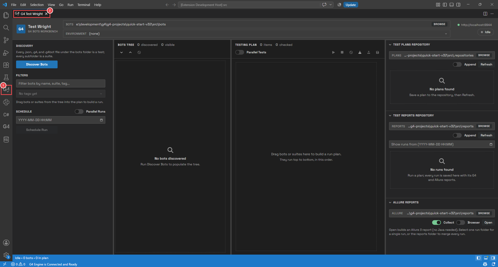
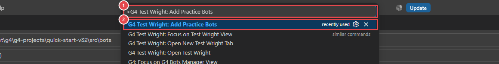
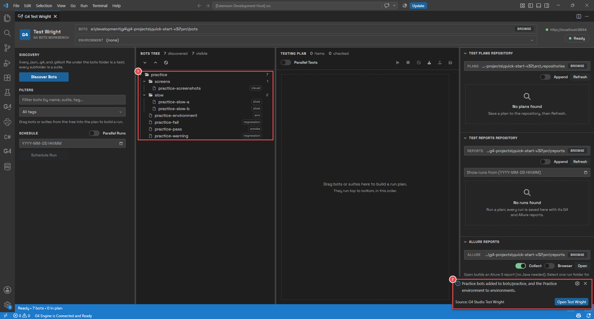
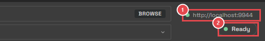
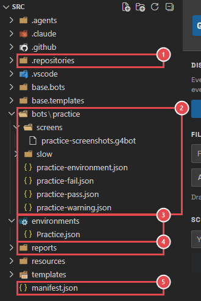

# Module 1: Get set up

[⬅ Back to overview](README.md)

⏱️ **About 5 minutes**

📍 **Where you are:** before the line starts. You'll open Test Wright and put some practice **bots** in your project, so every later module has something to work with.

In this module, you will:

- Open Test Wright
- Add the practice bots to your project
- Check that Test Wright can reach the G4 engine
- See the folders Test Wright uses

---

## Step 1: Open Test Wright

1. **The Test Wright icon** — in the Activity Bar on the far left of VS Code. It shows the letters **G4** with a small check mark. Click it once: Test Wright opens.
2. **The Test Wright tab** — the page opens as a tab, like a file. You can move it, split it, or close it like any other tab.

> **📝 Note:** Do not confuse it with the **G4** icon a little lower (without the check mark). That one belongs to the G4 Engine Client extension.

---

## Step 2: Add the practice bots

The practice bots are seven small bots made for this learning path. They use a built-in **simulator**, so they run without a browser or a driver — only the G4 engine is needed.

Press `F1` (or `Ctrl+Shift+P`, `Cmd+Shift+P` on a Mac) to open the **Command Palette**.

1. **The search box** — type **Add Practice Bots**.
2. **The command** — click **G4 Test Wright: Add Practice Bots**, or press `Enter`.

Test Wright copies the bots into your project and shows them straight away:

1. **The practice bots** — they appear in the **Bots Tree** in the middle of the page (Module 3 explains it).
2. **The confirmation** — tells you where the files went: the bots in `bots/practice`, and a **Practice** environment in `environments`.

> **💡 Tip:** You can run the command again at any time. It never overwrites a file, so changes you made to a practice bot are kept. To get a fresh copy of a bot, delete the file first.

---

## Step 3: Check the engine

Test Wright does not run bots itself. It sends them to the **G4 engine** and shows what the engine answers. So the engine must be running.

1. **The engine** — the address Test Wright sends your bots to. The dot before it is **green** when the engine answers, and **red** when it doesn't. Click it to check again.
2. **The status** — what Test Wright is doing right now: **Idle**, **Ready**, **Running**, **Scheduled**, or **Failed** (the last run had a failure).

> **📝 Note:** The address comes from the `g4Server` section of your project's `manifest.json`. Without it, Test Wright uses `http://localhost:9944`, the address of the G4 sandbox.

---

## Step 4: See the folders Test Wright uses

Click the **Explorer** icon (the top icon in the Activity Bar) to see your project's files.

1. **`.repositories`** — where Test Wright keeps the plans you save (Module 5).
2. **`bots`** — your bots. The practice bots are in `bots/practice`.
3. **`environments`** — one file per environment (Module 6). `Practice.json` came with the practice bots.
4. **`reports`** — every run you make is saved here (Module 8).
5. **`manifest.json`** — your project's settings, such as the engine address and your G4 token.

> **📝 Note:** Test Wright creates the `.repositories` and `reports` folders by itself when VS Code opens your project, so they are always there.

Click the Explorer icon again to hide the file list.

---

## 🧪 Try it

Add the practice bots, then click the engine address in the top-right corner.

**You should see:** seven practice bots in the Bots Tree, and a **green** dot before the engine address.

---

## ✔ Check your work

- [ ] Test Wright is open in a tab
- [ ] The practice bots are in the Bots Tree
- [ ] The engine dot is green
- [ ] You know where your plans (`.repositories`) and runs (`reports`) are kept

---

**Next up** 👉 [Module 2: Tour the workbench](02-tour-the-workbench.md)
