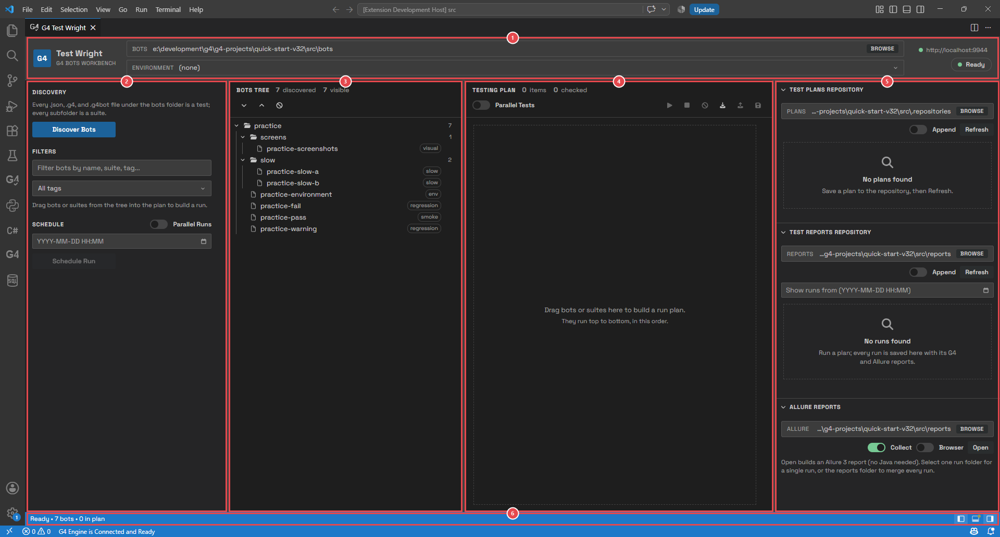
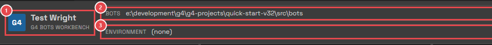
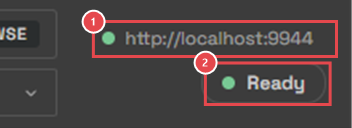
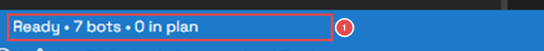
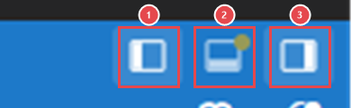
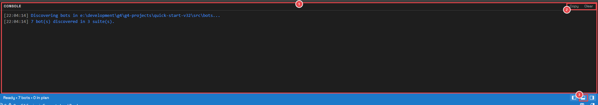
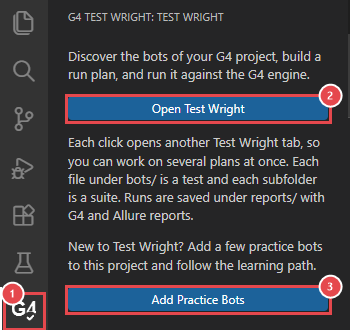
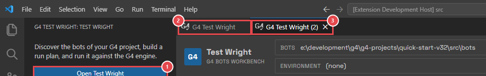

# Module 2: Tour the workbench

[⬅ Back to overview](README.md)

⏱️ **About 4 minutes**

📍 **Where you are:** a quick look at the whole line. Before you touch anything, you'll learn where each part of the picture lives on the page.

In this module, you will:

- Learn the five areas of the page
- Read the header
- Show and hide areas, and read the console
- Open a second Test Wright tab

---

## Step 1: Meet the five areas

1. **Header** — which bots folder you use, which environment, and whether the engine is ready.
2. **Left sidebar** — the tools that act on the whole page: **Discovery** (find your bots), **Filters** (show only some bots), and **Schedule** (run later).
3. **Bots Tree** — every bot of your project, in its folders. This is where you **pick** bots.
4. **Testing Plan** — the bots you picked, in the order they will run. This is what **Run** runs.
5. **Right sidebar** — what you keep: **Test Plans Repository** (saved plans), **Test Reports Repository** (past runs), and **Allure Reports**. Click a section's title to fold it away.
6. **Status bar** — a one-line summary, and buttons to show or hide areas.

The page reads from left to right, like the picture in the overview: bots on the left, the plan in the middle, results on the right.

---

## Step 2: Read the header

1. **Test Wright** — the name of the page.
2. **Bots** — the folder Test Wright reads bots from. It is your project's `bots` folder. Click **Browse** to use another folder.
3. **Environment** — the environment your bots will use. **(none)** means no environment. Module 6 covers it.

1. **Engine** — the address of the G4 engine. Green dot: it answers. Red dot: it doesn't.
2. **Status** — what Test Wright is doing now (**Ready**, **Running**, **Scheduled**…).

---

## Step 3: Show, hide, and read the console

At the bottom of the page is the status bar.

1. **Summary** — the status, how many bots were found, how many are in the plan, and the environment.

1. **Left sidebar** — shows or hides it.
2. **Console** — shows or hides the console. A small dot on it means there are new messages.
3. **Right sidebar** — shows or hides it.

Click the middle button to open the **console**:

1. **Console** — Test Wright's diary. Every action leaves a line here: bots found, runs started, bots finished, where a run was saved, and any problem. Drag its top edge to make it taller.
2. **Copy** and **Clear** — copy every line (for example, to send to a teammate), or empty the console.
3. **Console button** — click it again to hide the console.

> **💡 Tip:** Drag the thin lines between the areas to make them wider or narrower. Test Wright remembers your layout, your folders, and your plan the next time you open it.

---

## Step 4: Open a second Test Wright tab

You can have several Test Wright tabs, for example to build one plan while another runs.

Click the Test Wright icon in the Activity Bar while Test Wright is already open. The side bar opens:

1. **Test Wright icon** — click it to show or hide this side bar.
2. **Open Test Wright** — every click opens one more Test Wright tab.
3. **Add Practice Bots** — the same command you used in Module 1.

1. **Open Test Wright** — the button you clicked.
2. **The first tab** — still there, as you left it.
3. **The new tab** — named **G4 Test Wright (2)**.

Each tab has its own plan, and its console shows only the runs started from that tab. Scheduled runs (Module 10) show in every tab.

---

## 🧪 Try it

Hide both sidebars, open the console, then bring everything back.

**You should see:** the Bots Tree and the plan fill the page while the sidebars are hidden, and the page looks as before once you bring them back.

---

## ✔ Check your work

- [ ] You can name the five areas and what each one is for
- [ ] You can show and hide the sidebars and the console
- [ ] You know how to open a second Test Wright tab (and you closed it again)

---

**Next up** 👉 [Module 3: Discover your bots](03-discover-your-bots.md)
