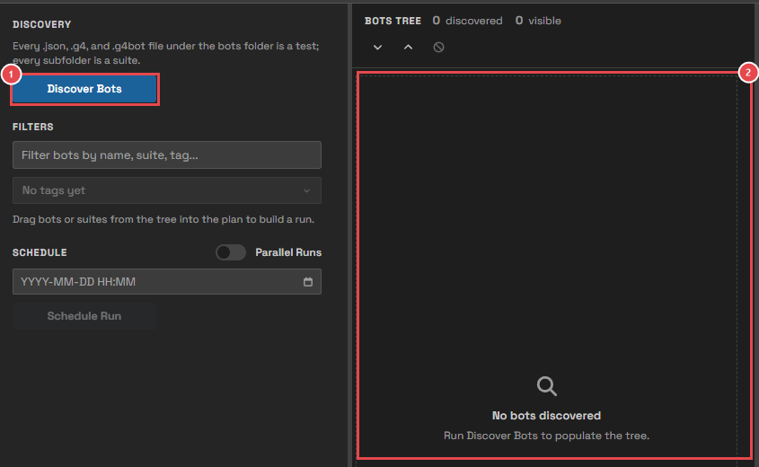
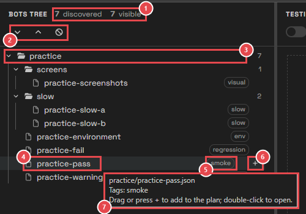
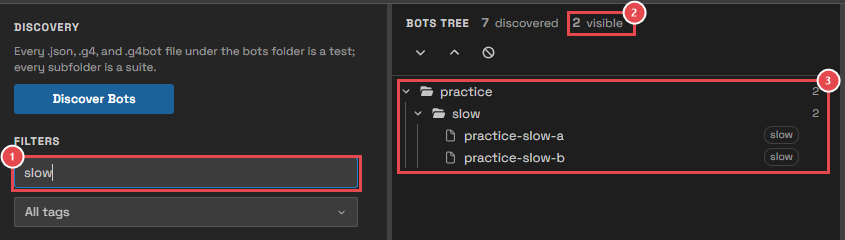
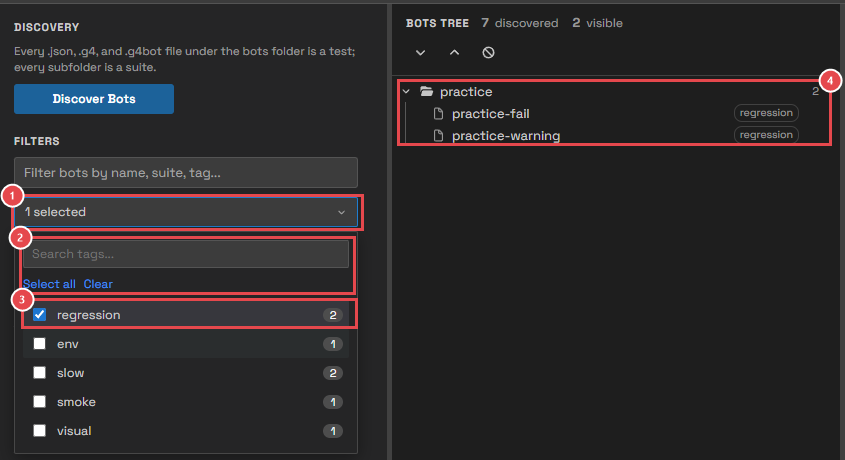
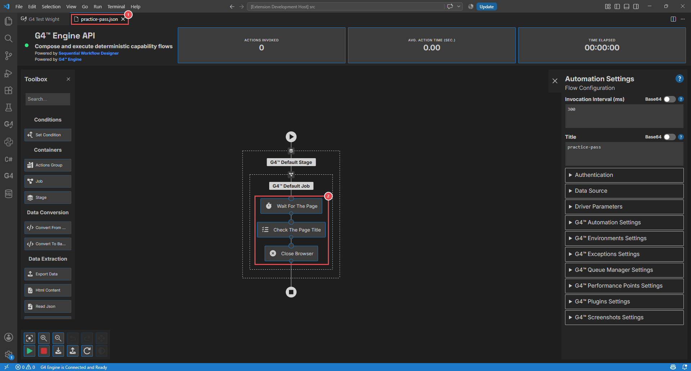

# Module 3: Discover your bots

[⬅ Back to overview](README.md)

⏱️ **About 6 minutes**

📍 **Where you are:** **Bots**, the start of the line. Before you can run bots, Test Wright needs to find them and show them to you.

In this module, you will:

- Fill the Bots Tree with **Discover Bots**
- Learn the parts of the tree
- Find bots by name and by tag
- Open a bot to see what it does

---

## Step 1: Discover your bots

**Discover Bots** reads your bots folder and lists every bot it finds. Test Wright does this by itself when it opens, so usually the tree is already full. Press it again whenever you add, rename, or delete bots.

1. **Discover Bots** — reads the bots folder again.
2. **Bots Tree** — empty until bots are found. After discovery, it lists them.

How Test Wright decides what is a bot:

- Every `.json`, `.g4`, and `.g4bot` file under the bots folder is a bot — one **test**.
- Every folder is a **suite**. Folders inside folders are suites inside suites.
- Folders whose name starts with a dot, and the `reports` folder, are skipped.

> **📝 Note:** A file that is not a G4 bot (it isn't valid JSON, or it has no stages) is skipped, and the console says which file and why. One broken file never stops the discovery.

---

## Step 2: Read the tree

1. **Counts** — how many bots were found, and how many are visible right now (filters can hide some).
2. **Tree buttons** — expand every suite, collapse every suite, and clear the tree.
3. **A suite** — a folder of bots. Click it to open or close it. The number on the right is how many bots it holds.
4. **A bot** — one test. Its name is the file name without the extension.
5. **Tag** — the bot's first tag. A **+1** next to it means it has more tags.
6. **The + button** — appears when you point at a row. Click it to add the bot (or the whole suite) to the end of the plan.
7. **Tooltip** — point at a bot for a moment to see its file, all its tags, and its last result.

After a run, a small mark at the end of each bot's row shows its last result: ✓ passed, ✗ failed, ⚠ warning.

### Use the keyboard

Click a row once, then:

| Key | What it does |
| --- | --- |
| `↑` `↓` | Move to the row above or below |
| `→` | Open a suite (or step into it) |
| `←` | Close a suite (or go up to its suite) |
| `Home` `End` | Jump to the first or last row |
| `Enter` | Add the row's bots to the end of the plan |
| `Space` | Open the bot, or open/close the suite |

---

## Step 3: Find bots by name

When you have many bots, the filter box shows only the ones you want.

1. **Filter box** — type part of a bot's name, its suite, or a tag.
2. **Visible** — how many bots match.
3. **The tree** — shows only the matching bots, still inside their suites.

Empty the box to see every bot again.

---

## Step 4: Find bots by tag

A **tag** is a short label written in the bot, such as `smoke` (a quick check) or `regression` (a full check). Tags let you pick a whole group of bots at once, wherever they are.

1. **Tag filter** — click it to open the list. It says how many tags are ticked.
2. **Search, Select all, Clear** — find a tag by typing; tick or untick every tag at once.
3. **A tag** — tick it to show its bots. The number is how many bots carry it.
4. **The tree** — shows only bots with a ticked tag.

Bots without tags are grouped under **untagged**. Press `Esc` or click outside the list to close it. Module 11 shows how to add a tag to a bot.

---

## Step 5: Open a bot

Double-click a bot (or select it and press `Space`). It opens in the **G4 Workflow Editor**, which shows its steps as a flow chart.

1. **The bot's tab** — the bot opens next to Test Wright. Close it like any other tab.
2. **The bot's steps** — practice-pass waits for the page, checks the page's text, and closes. Module 11 looks closer at these steps.

> **📝 Note:** The Workflow Editor comes from the **G4 Engine Client** extension. Without it, the bot opens as text instead.

---

## 🧪 Try it

Show only the bots tagged **slow**, then open **practice-pass** in the Workflow Editor.

**You should see:** two bots (**practice-slow-a** and **practice-slow-b**) in the tree, then the steps of practice-pass in a new tab. Clear the tag filter and close the tab when you are done.

---

## ✔ Check your work

- [ ] You pressed **Discover Bots** and the tree shows seven practice bots
- [ ] You know the difference between a **suite** and a **bot**
- [ ] You filtered by name and by tag, then cleared both
- [ ] You opened a bot in the Workflow Editor

---

**Next up** 👉 [Module 4: Build a run plan](04-build-a-run-plan.md)
