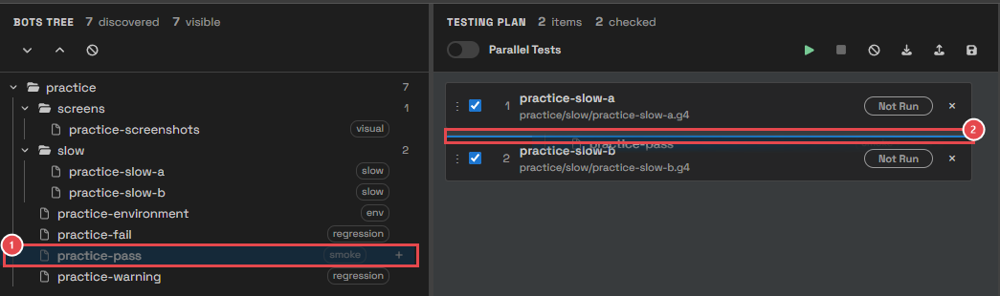
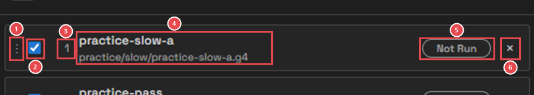
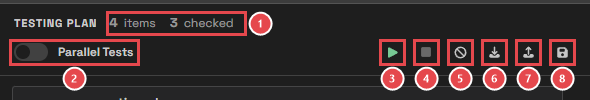
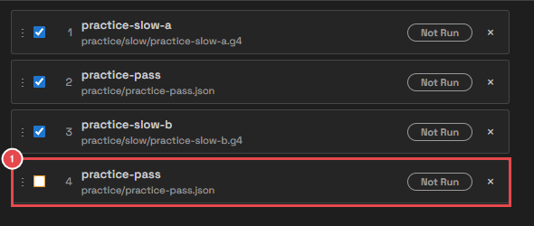
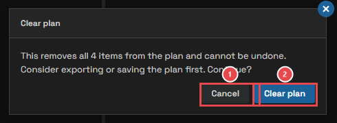

# Module 4: Build a run plan

[⬅ Back to overview](README.md)

⏱️ **About 6 minutes**

📍 **Where you are:** **Plan**, the second stop on the line. The plan says **which** bots to run and **in what order**. Only bots in the plan run.

In this module, you will:

- Drag bots and suites into the plan
- Learn the parts of a plan row and of the plan's toolbar
- Reorder the plan, and choose which rows run
- Clear the plan

---

## Step 1: Drag bots into the plan

Point at a bot or a suite in the Bots Tree, press the mouse button, and drag it onto the **Testing Plan**.

1. **The bot you drag** — from the Bots Tree. Drag a **suite** to add all of its bots at once.
2. **The drop line** — a blue line shows where the bot will land. Drop it between two rows to put it exactly there; drop it below the last row to add it at the end.

Other ways to add bots:

- Click the **+** button at the end of a bot's or suite's row in the tree.
- Select a row in the tree and press `Enter`.

> **💡 Tip:** You can add the same bot more than once, for example to run it before and after another bot.

---

## Step 2: Read a plan row

1. **Handle** — grab the row here to drag it up or down.
2. **Include switch** — rows switched on run; rows switched off stay in the plan but are skipped. Handy to leave a bot out for one run without losing it.
3. **Order** — the position in the plan. The plan runs from 1 down.
4. **Name and path** — the bot's name, and its suite and file.
5. **Status** — **Not Run** until the plan runs; then the bot's result (Module 7 explains every status).
6. **Remove** — takes the row out of the plan. The bot file is not touched.

Point at a row to see its file and, after a run, its result message.

---

## Step 3: Use the plan's toolbar

1. **Counts** — how many rows are in the plan, and how many are switched on (will run).
2. **Parallel Tests** — off: the bots run one after another. On: several run at the same time. Module 7 shows the difference.
3. **Run** — runs every row that is switched on.
4. **Stop** — stops the run (active only while a run is going).
5. **Clear plan** — removes every row.
6. **Import** — loads a plan from a file.
7. **Export** — saves the plan to a file of your choice.
8. **Save to repository** — saves the plan in your project, to use it again later.

Module 5 covers buttons 6–8, and Module 7 covers buttons 2–4.

---

## Step 4: Arrange the plan

- **Move a row:** drag it by its handle to a new place. The drop line shows where it will land.
- **Skip a row:** switch it off.
- **Remove a row:** click its **×**.

1. **A row switched off** — this second copy of practice-pass stays in the plan but will not run. The toolbar now says **4 items, 3 checked**.

> **📝 Note:** The plan runs **top to bottom** when Parallel Tests is off. The order matters when one bot prepares something the next bot uses.

---

## Step 5: Clear the plan

Click **Clear plan** to start over. Test Wright asks first, because this cannot be undone:

1. **Cancel** — keeps the plan as it is.
2. **Clear plan** — empties the plan. The bot files are not touched.

> **💡 Tip:** Want to keep this plan for later? Save it first — that's the next module.

---

## 🧪 Try it

Build this plan: **practice-slow-a**, **practice-slow-b**, then **practice-pass** twice. Then switch off the second practice-pass.

**You should see:** four rows, and the toolbar says **4 items, 3 checked**. Keep this plan for the next module.

---

## ✔ Check your work

- [ ] You added bots by dragging, with the **+** button, and with `Enter`
- [ ] You moved a row to another place
- [ ] You know that only rows **switched on** run
- [ ] You know what each toolbar button does

---

**Next up** 👉 [Module 5: Keep your plans](05-keep-your-plans.md)
