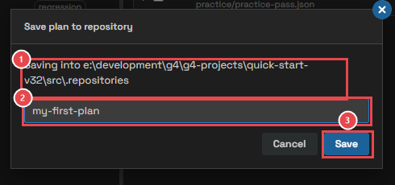
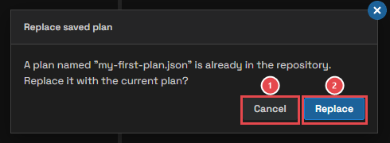
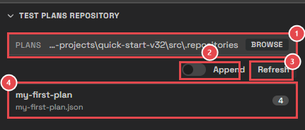
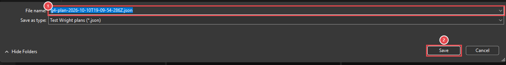

# Module 5: Keep your plans

[⬅ Back to overview](README.md)

⏱️ **About 5 minutes**

📍 **Where you are:** **Saved plans**, the helper next to **Plan**. A plan you build once can be kept and used again tomorrow, or shared with a teammate.

In this module, you will:

- Save a plan in your project
- Load a saved plan, or add it to the current one
- Share a plan as a file

---

## Step 1: Save the plan to the repository

The **repository** is the `.repositories` folder of your project. Plans saved there are listed in the right sidebar, ready to load.

Click **Save to repository** (the last button of the plan's toolbar):

1. **Where** — the folder the plan is saved in.
2. **Name** — type a name you'll recognize, such as `my-first-plan`. Test Wright suggests a name with today's date.
3. **Save** — saves the plan. Pressing `Enter` does the same.

The plan file keeps the bots, their order, which rows are switched on, and the Parallel Tests setting.

If a plan with that name is already saved, Test Wright asks before replacing it:

1. **Cancel** — keeps the saved plan as it was. Save again under another name.
2. **Replace** — overwrites the saved plan with the current one.

---

## Step 2: Find your saved plans

In the right sidebar, open **Test Plans Repository**:

1. **Plans folder** — where saved plans are read from. Click **Browse** to use another folder, for example a shared one.
2. **Append** — off: loading a plan **replaces** the current plan. On: loading **adds** it to the end of the current plan.
3. **Refresh** — reads the folder again, for example after a teammate added a plan.
4. **A saved plan** — its name, its file, and how many rows it holds.

---

## Step 3: Load a saved plan

Do one of these:

- **Drag** the saved plan onto the Testing Plan.
- **Double-click** the saved plan.

If your current plan is not empty and **Append** is off, Test Wright asks before replacing it.

> **💡 Tip:** Turn **Append** on to combine plans, for example a "login" plan followed by a "checkout" plan.

---

## Step 4: Share a plan as a file

Saved plans live in your project. To give a plan to someone else, or keep it somewhere else, use the plan's toolbar:

- **Export** (the arrow pointing up) — saves the plan to a file anywhere on your computer:

  

  1. **File name** — the name of the plan file.
  2. **Save** — writes the file.

- **Import** (the arrow pointing down) — opens a plan file and loads it. Test Wright asks before replacing a plan that is not empty.

> **📝 Note:** A plan remembers which bots folder its bots came from. A teammate whose project has the same bots, in the same folders, can run your plan as it is.

---

## 🧪 Try it

Save your plan from Module 4 as `my-first-plan`. Clear the plan. Then double-click **my-first-plan** in the Test Plans Repository.

**You should see:** the same four rows come back, with the second practice-pass still switched off.

---

## ✔ Check your work

- [ ] **my-first-plan** is listed in the Test Plans Repository
- [ ] You loaded it back into the plan
- [ ] You know what **Append** changes
- [ ] You know how to share a plan as a file

---

**Next up** 👉 [Module 6: Choose an environment](06-choose-an-environment.md)
