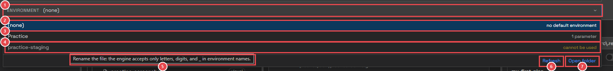
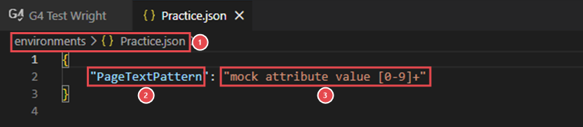

# Module 6: Choose an environment

[⬅ Back to overview](README.md)

⏱️ **About 5 minutes**

📍 **Where you are:** **Environment**, the helper that feeds **Run**. It lets the same bots test different places without changing the bots.

In this module, you will:

- Understand what an environment is
- Pick an environment for your runs
- Look inside an environment file
- Know which environments can't be used, and why

---

## What is an environment?

Your bots often need values that change from place to place: a web address, a user name, an expected text. Writing them inside each bot means changing every bot when you move from **staging** to **production**.

An **environment** keeps those values in one file. Each file in your project's `environments` folder is one environment — for example `Staging.json` and `Production.json`, with the same names but different values. A bot reads a value **by its name**, and gets the value of the environment in use.

---

## Step 1: Pick an environment

Click **Environment** in the header:

1. **Environment** — shows the environment in use. Click it to open the list.
2. **(none)** — run the bots without an environment.
3. **Practice** — an environment from your `environments` folder. The right side says how many values it holds.
4. **An environment that cannot be used** — shown greyed out, with **cannot be used** on the right. You can't pick it.
5. **Why** — point at it to see the reason. Here the file name has a `-`, and the engine accepts only letters, digits, and `_` in environment names.
6. **Refresh** — reads the `environments` folder again, after you add or rename a file.
7. **Open folder** — opens the `environments` folder on your computer.

Pick **Practice**. The header now shows **Practice**, and so does the summary in the status bar.

What happens when you press **Run**: Test Wright first sends the values of the chosen environment file to the G4 engine, then tells every bot to use that environment. So the engine always has the latest values from your file.

> **📝 Note:** An entry is also greyed out when its file is not valid JSON, or doesn't hold a list of names and values. Fix the file, then click **Refresh**.

---

## Step 2: Look inside an environment file

Open the file to see its values: press `Ctrl+P` (`Cmd+P` on a Mac), type `Practice.json`, and press `Enter`.

1. **Where** — the file is in the `environments` folder. Its name, without `.json`, is the environment's name.
2. **A name** — `PageTextPattern`. Bots ask for the value by this name.
3. **Its value** — the text the bot gets. The **practice-environment** bot checks that the page's text matches this pattern.

An environment file is a list of `"name": "value"` pairs, separated by commas, between `{` and `}`. Numbers and true/false values work too; Test Wright sends them as text.

---

## 🧪 Try it

1. Make sure **Practice** is picked in the header.
2. Add **practice-environment** to an empty plan and press **Run**. It passes.
3. In `Practice.json`, change the value to `"Hello"` and save the file (`Ctrl+S`).
4. Run again.

**You should see:** **Failed** the second time, because the page's text is not `Hello`. The engine used your new value without any change to the bot. Put the value back to `"mock attribute value [0-9]+"`, save, and run once more: **Passed**.

---

## ✔ Check your work

- [ ] You can explain what an environment is for
- [ ] **Practice** is picked in the header
- [ ] You changed an environment value and saw the bot's result change
- [ ] You know why an environment can be greyed out

---

**Next up** 👉 [Module 7: Run and watch](07-run-and-watch.md)
