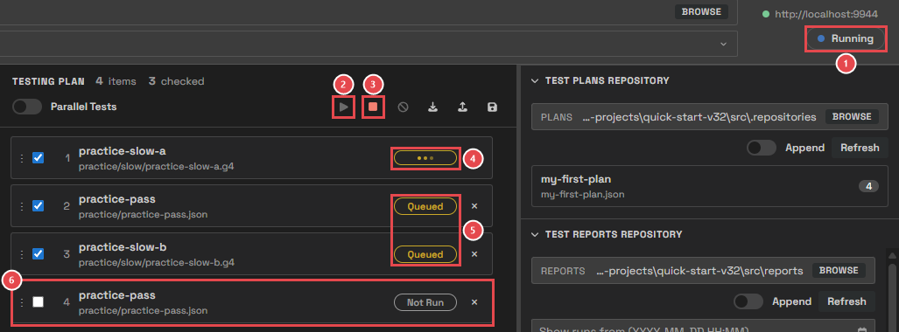
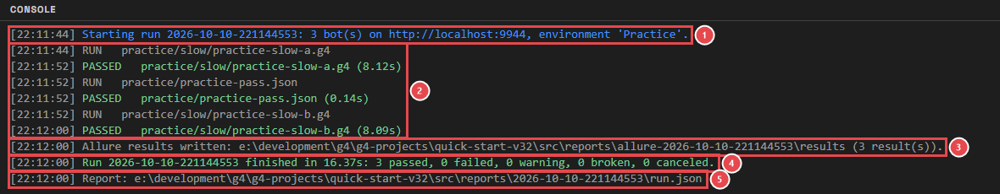
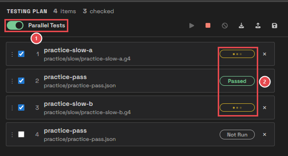
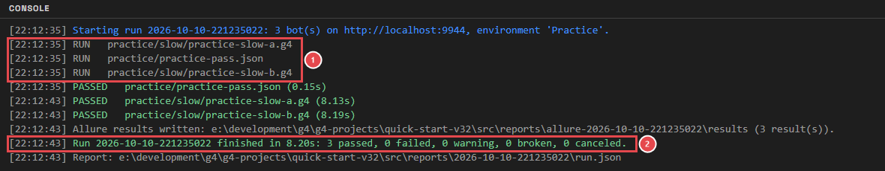
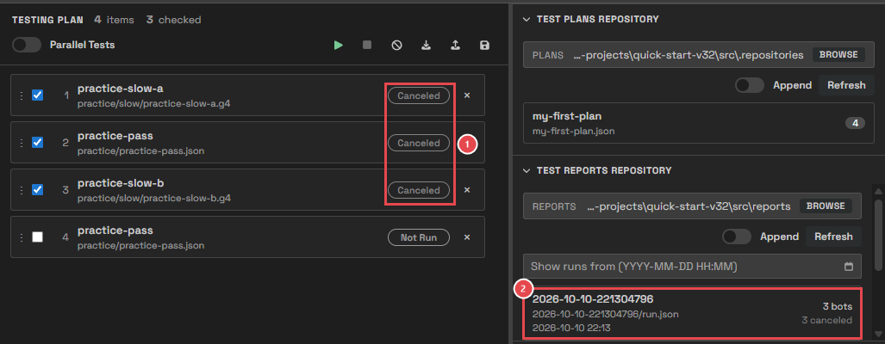
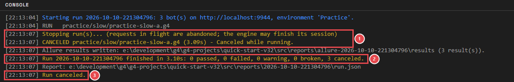

# Module 7: Run and watch

[⬅ Back to overview](README.md)

⏱️ **About 6 minutes**

📍 **Where you are:** **Run**, the middle of the line. The plan goes to the G4 engine, and every bot's result comes back while you watch.

In this module, you will:

- Run the plan and follow each bot
- Read the console while a run goes
- Run bots in parallel to finish sooner
- Stop a run

---

## Step 1: Press Run

Load **my-first-plan** (or build a plan of **practice-slow-a**, **practice-pass**, **practice-slow-b**), then click **Run** — the green play button above the plan.

1. **Status: Running** — Test Wright is busy until every bot is done.
2. **Run** — greyed out while a run goes.
3. **Stop** — turns red: you can stop the run now.
4. **Running** — three moving dots: this bot is with the engine right now.
5. **Queued** — waiting for its turn.
6. **Switched off** — this row is skipped, so it stays **Not Run**.

When a bot finishes, its row shows its result:

| Status | What it means |
| --- | --- |
| **Not Run** | The row has not run yet (or was skipped) |
| **Queued** | Waiting for its turn |
| **Running** | With the engine right now |
| **Passed** | Done, and no check failed |
| **Failed** | Done, and at least one check (assertion) was false |
| **Warning** | Done, no check failed, but something went wrong on the way — for example a button that couldn't be clicked |
| **Broken** | No usable answer: the engine couldn't be reached, or the bot file couldn't be read |
| **Canceled** | Stopped before it finished |

Module 8 shows how to find out **why** a bot got its status.

---

## Step 2: Read the console during a run

Open the console (the middle button at the bottom right). Each line tells you what happened, with the time:

1. **Start** — the run's name (the date and time it started), how many bots, the engine, and the environment.
2. **Each bot** — **RUN** when it starts; **PASSED**, **FAILED**, **WARNING**, … when it ends, with how long it took.
3. **Allure** — where the Allure results were written (Module 9).
4. **Summary** — how long the whole run took, and how many bots got each status.
5. **Report** — where the run was saved (Module 8).

---

## Step 3: Run bots in parallel

**Parallel Tests**, above the plan, decides how the bots of one run share the engine:

- **Off** — one bot at a time, top to bottom. Use it when bots depend on each other, for example when one bot creates the user the next bot logs in with.
- **On** — several bots at the same time (up to one per processor core of your computer). Use it when the bots don't depend on each other, to finish sooner.

1. **Parallel Tests** — switched on.
2. **Several bots running at once** — both slow bots run together, and practice-pass already passed.

The console shows the difference:

1. **All bots start together** — three **RUN** lines at the same second.
2. **Shorter run** — about 8 seconds, instead of about 16 one at a time.

---

## Step 4: Stop a run

Click **Stop** (the red square) at any time:

1. **Canceled** — the bot that was running and the bots still waiting are marked **Canceled**.
2. **The run is still saved** — with what finished, so nothing is lost. It appears in the Test Reports Repository.

1. **Stopping** — Test Wright stops waiting for the engine and marks the running bot **CANCELED**.
2. **Summary** — the run ends at once, with its counts.
3. **Run canceled** — confirms you stopped it.

> **📝 Note:** Stop ends the run on the Test Wright side right away. The engine may still finish the step it was doing.

---

## What is sent to the engine?

Each bot is sent as it is in its file, plus a few values from your project's `manifest.json`:

- The **token** in the manifest is always used.
- Anything the bot doesn't set itself (for example the driver) is taken from the manifest.
- Anything the bot **does** set stays as the bot has it.
- The environment you picked becomes the bot's environment.

Your bot files are never changed.

---

## 🧪 Try it

Run your plan with **Parallel Tests** off, then with it on. Compare the run times in the console's summary lines.

**You should see:** about 16 seconds with Parallel Tests off, and about 8 seconds with it on. Then start one more run and press **Stop** after a second or two: the rows turn **Canceled**.

---

## ✔ Check your work

- [ ] You ran a plan and every row switched on ended with a status
- [ ] You can explain the difference between **Failed**, **Warning**, and **Broken**
- [ ] You ran the same plan with Parallel Tests off and on
- [ ] You stopped a run

---

**Next up** 👉 [Module 8: Read the results](08-read-the-results.md)
