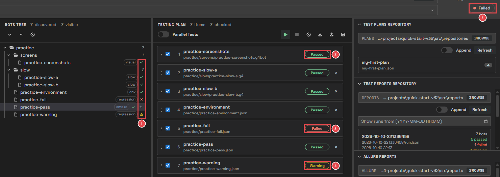
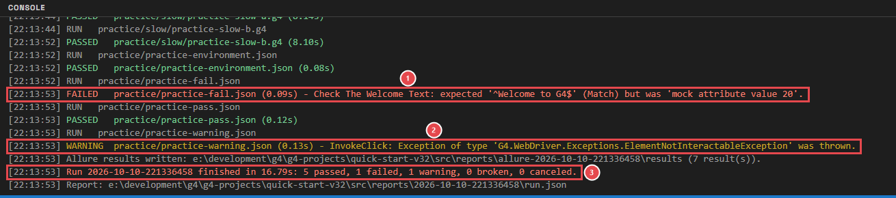
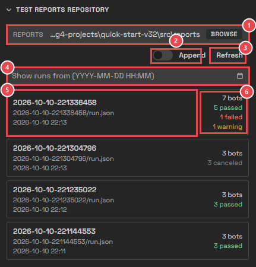
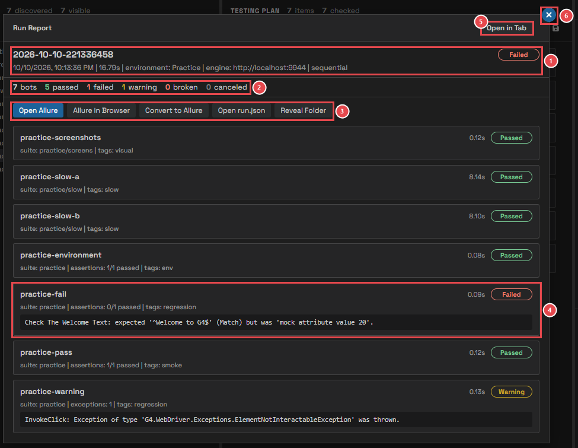
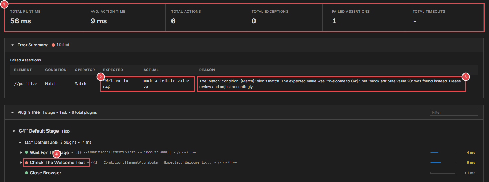
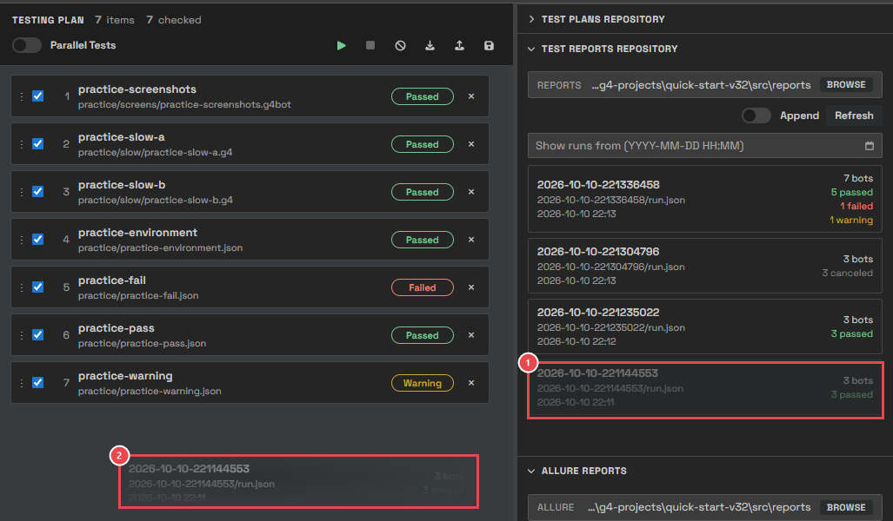
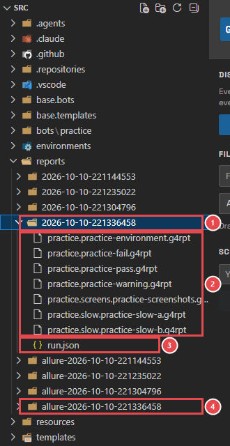
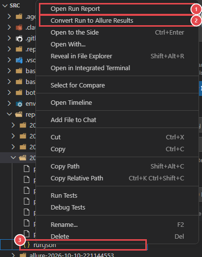

# Module 8: Read the results

[⬅ Back to overview](README.md)

⏱️ **About 8 minutes**

📍 **Where you are:** **Results**, the fourth stop on the line. Every run is saved. Here you learn to read a run, and to find out **why** a bot didn't pass.

In this module, you will:

- Read the result of every bot at a glance
- Find a past run in the Test Reports Repository
- Open a run's summary and a bot's G4 report
- Run the bots of an old run again
- Know where a run's files are

Before you start, put **every practice bot** in the plan (drag the **practice** suite onto an empty plan), pick the **Practice** environment, and press **Run**. Some bots will not pass — on purpose.

---

## Step 1: See the results at a glance

1. **Last result in the tree** — ✓ passed, ✗ failed, ⚠ warning. They stay until the next run of that bot, so you can see which bots need attention without opening anything.
2. **Passed** — the bot finished and no check failed.
3. **Failed** — at least one check was false. **practice-fail** checks for a text the page doesn't have.
4. **Warning** — no check failed, but a step had a problem. **practice-warning** tries to click a button that isn't there.
5. **Status: Failed** — the last run had at least one failed or broken bot.

The console already says why each bot didn't pass:

1. **FAILED** — the name of the check, the value it **expected**, and the value it **found**.
2. **WARNING** — the step that had the problem, and the problem.
3. **Summary** — the counts of the whole run.

> **💡 Tip:** You can also point at a plan row to read its result message.

---

## Step 2: Find a run in the Test Reports Repository

In the right sidebar, open **Test Reports Repository**. It lists every saved run, newest first.

1. **Reports folder** — where runs are read from: your project's `reports` folder. Click **Browse** to use another one.
2. **Append** — used when you drag a run onto the plan (Step 5): off replaces the plan, on adds to it.
3. **Refresh** — reads the folder again.
4. **Show runs from** — pick a date and time to see only newer runs. Clear it to see all runs.
5. **A run** — its name (the date and time it started, as `year-month-day-time`), its file, and when it ran. A scheduled run also shows its label.
6. **Counts** — how many bots ran, and how many passed, failed, got a warning, or were canceled.

---

## Step 3: Open the run summary

Click a run. The **Run Report** opens over the page:

1. **The run** — its name and overall status, when it ran, how long it took, the environment, the engine, and whether its bots ran one by one or in parallel.
2. **Counts** — bots, passed, failed, warning, broken, canceled.
3. **Tools** — open the Allure report (Module 9), convert the run to Allure, open the `run.json` file, or open the run's folder on your computer.
4. **A bot that didn't pass** — its suite, its checks (**0/1 passed**), its tags, and the reason, in the dark box. Click any bot to open its G4 report.
5. **Open in Tab** — shows the same report in its own VS Code tab.
6. **Close** — or press `Esc`.

---

## Step 4: Open a bot's G4 report

Click **practice-fail** in the Run Report. Its **G4 automation report** opens in a new tab. It records every step the bot took:

1. **Summary** — how long the bot ran, how many steps (actions) it took, how many problems (exceptions) and failed checks it had.
2. **Expected and actual** — what the check wanted (`^Welcome to G4$`), and what it found (`mock attribute value 20`). This is usually all you need to fix the bot.
3. **Reason** — the same, in a sentence.
4. **The failed step** — in the **Plugin Tree**, each step has a dot: green for good, red for the step that failed. The **Execution Timeline** below shows how long each step took.

> **📝 Note:** A **Broken** bot has no G4 report: the engine never answered, so there is nothing to show. Its row in the Run Report explains why.

| Status | Where to look |
| --- | --- |
| **Failed** | The **Error Summary** of the G4 report: expected versus actual. |
| **Warning** | The bot's message names the step and its problem. The G4 report shows the step in red. |
| **Broken** | The message says why the engine gave no answer, such as **Engine unreachable**. See [Troubleshooting](troubleshooting.md). |

---

## Step 5: Run the bots of an old run again

Drag a run from the Test Reports Repository onto the Testing Plan:

1. **The run you drag** — from the Test Reports Repository.
2. **Drop it on the plan** — its bots replace the plan (Test Wright asks first), ready to run again. Turn **Append** on to add them to the end instead.

---

## Where are the files?

Every run is a folder in your project's `reports` folder. Click the Explorer icon to see it:

1. **The run's folder** — named after the date and time the run started.
2. **One G4 report per bot** — the files ending in `.g4rpt`.
3. **`run.json`** — the run's summary: every bot, its status, and its message.
4. **The run's Allure folder** — next to the run, with the same name and `allure-` in front (Module 9).

Right-click any `run.json` to open its report without Test Wright's page:

1. **Open Run Report** — opens the Run Report in a tab.
2. **Convert Run to Allure Results** — writes the run's Allure files (Module 9).
3. **`run.json`** — the file you right-clicked.

---

## 🧪 Try it

Find out why **practice-fail** failed, using only the G4 report.

**You should see:** the check **Check The Welcome Text** expected `^Welcome to G4$` but found `mock attribute value` followed by a number. You'll fix this bot in Module 11.

---

## ✔ Check your work

- [ ] You read the results of a run in the plan, the tree, and the console
- [ ] You opened a run from the Test Reports Repository
- [ ] You opened the G4 report of a failed bot and found **expected** and **actual**
- [ ] You know where a run's files are

---

**Next up** 👉 [Module 9: Open the Allure report](09-open-the-allure-report.md)
