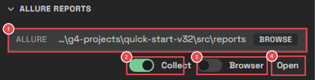
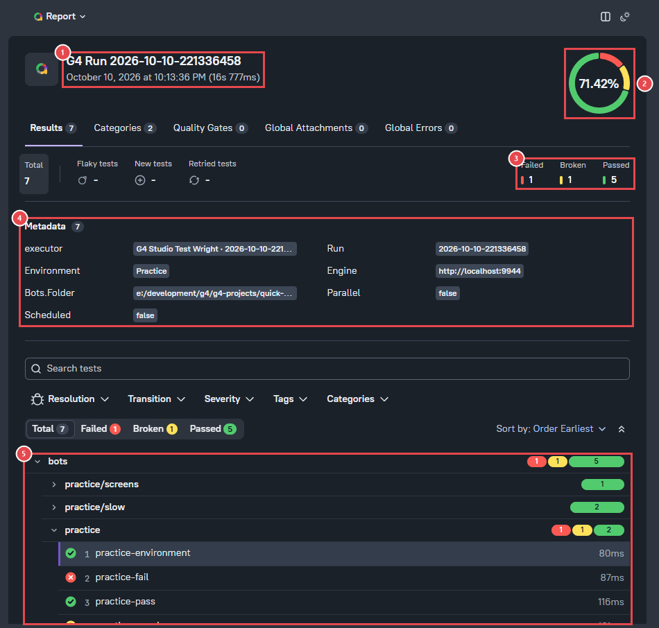
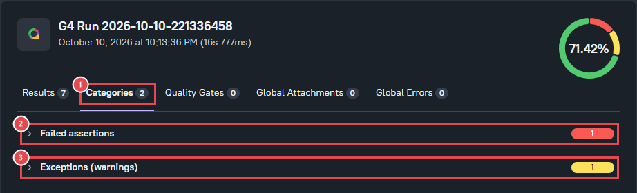
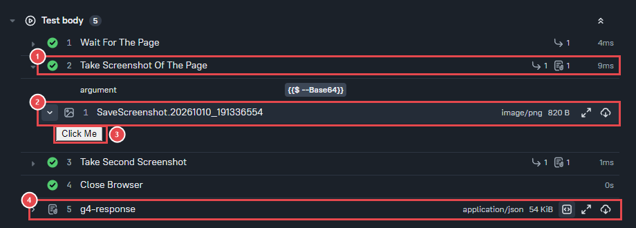
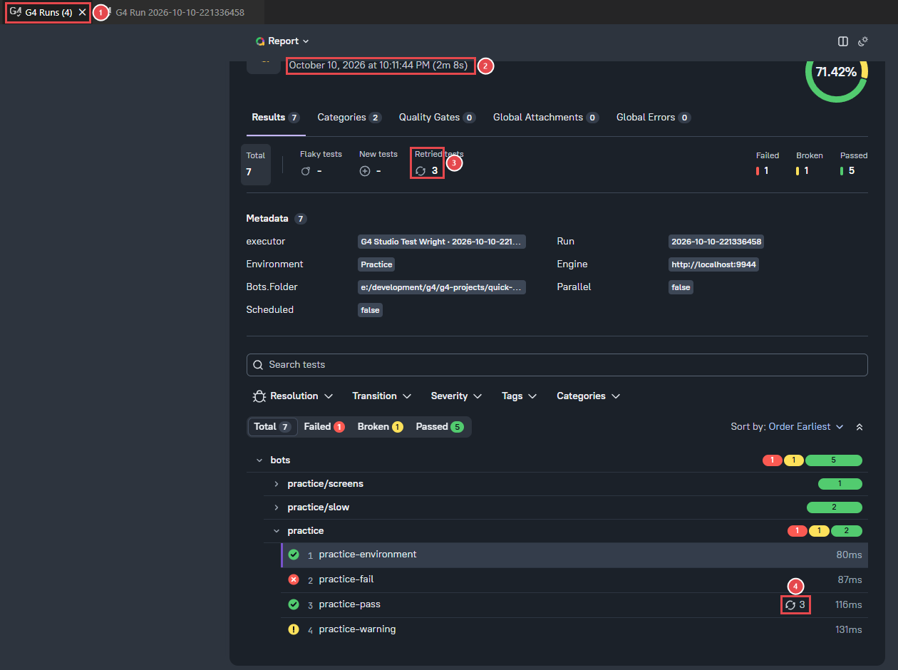

# Module 9: Open the Allure report

[⬅ Back to overview](README.md)

⏱️ **About 6 minutes**

📍 **Where you are:** **Allure**, the end of the line. Your results become a clear report — with charts, groups, and every step — that you can read or share.

[Allure](https://allurereport.org) is a popular kind of test report. Test Wright builds it for you, with nothing else to install.

In this module, you will:

- Make sure your runs collect Allure results
- Open the Allure report of one run
- Read the report: overview, categories, and steps with screenshots
- Merge all your runs into one report

---

## Step 1: Collect Allure results

In the right sidebar, open **Allure Reports**:

1. **Allure folder** — what **Open** builds a report from. By default it is your reports folder, which means **all your runs**. Click **Browse** to pick one run's folder instead.
2. **Collect** — on (the default): every run also writes its Allure results, in the `allure-` folder next to the run. Leave it on.
3. **Browser** — off: reports open in a VS Code tab. On: they open in your web browser.
4. **Open** — builds the report and opens it.

> **📝 Note:** Ran a plan with **Collect** off? No problem: opening that run's Allure report converts it first. You can also click **Convert to Allure** in the Run Report.

---

## Step 2: Open the report of one run

Click your last run in the Test Reports Repository, then click **Open Allure** in the Run Report. The first time takes a few seconds.

1. **The run** — its name, when it ran, and how long it took.
2. **Success rate** — the share of bots that passed. The ring's colors show passed (green), failed (red), and broken (yellow).
3. **Counts** — failed, broken, and passed.
4. **Metadata** — the run's details: the environment, the engine, the bots folder, and more.
5. **The tests** — grouped by suite. Click a suite to open it, and a test to see its steps.

Test Wright's statuses become Allure's:

| Test Wright | Allure |
| --- | --- |
| Passed | Passed |
| Failed | Failed |
| Warning, Broken | Broken |
| Canceled | Skipped |

---

## Step 3: See problems by category

Click the **Categories** tab. It groups the problems of the run by kind:

1. **Categories** — the tab.
2. **Failed assertions** — bots with a check that was false.
3. **Exceptions (warnings)** — bots that had a problem on the way.

Click a category to see its bots.

---

## Step 4: Read a test's steps

Go back to **Results**, open **practice/screens**, and click **practice-screenshots**. Under **Test body** you see every step the bot took:

1. **A step** — its name, its result (the green check), and how long it took. Click it to open it.
2. **A screenshot** — this step took a picture of the screen. Click it to show it.
3. **The picture** — the practice bots use a simulator, so the "screen" is just one button. A real bot shows the real page.
4. **g4-response** — the full answer of the engine, for experts.

> **💡 Tip:** To get screenshots in your own reports, add a **SaveScreenshot** step where you want a picture, or turn on automatic screenshots in the bot's **G4™ Screenshots Settings**.

---

## Step 5: Merge all your runs into one report

Close the Run Report, and in **Allure Reports** click **Open**. With the reports folder selected, Test Wright merges **every run** into one report:

1. **G4 Runs (4)** — the tab says how many runs are in the report.
2. **The time span** — from the first run to the last.
3. **Retried tests** — bots that ran in more than one run. Allure shows each bot's **latest** result and counts the older ones as retries.
4. **A bot's retries** — click the bot, then its **Retries** tab, to see its earlier results. This is how you see if a bot is getting better or worse over time.

> **📝 Note:** The report of one run is saved in its `allure-` folder, under `report`. The merged report is saved in `reports/allure-merged`. Both are plain web pages you can zip and send.

---

## 🧪 Try it

Open the Allure report of your last run and find the screenshot taken by **practice-screenshots**.

**You should see:** a step called **Take Screenshot Of The Page** with a picture attached.

---

## ✔ Check your work

- [ ] **Collect** is on
- [ ] You opened the Allure report of one run
- [ ] You found the failed bot under **Categories**
- [ ] You opened one report for all your runs

---

**Next up** 👉 [Module 10: Schedule a run](10-schedule-a-run.md)
