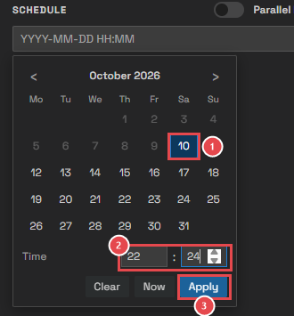
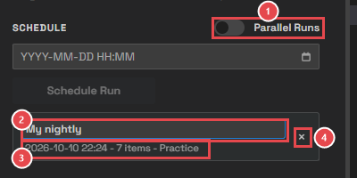
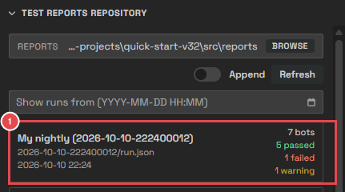

# Module 10: Schedule a run

[⬅ Back to overview](README.md)

⏱️ **About 6 minutes**

📍 **Where you are:** **Schedule**, the helper that starts **Run** for you. Pick a time, and the plan runs by itself — for example every evening, after everyone has left.

In this module, you will:

- Schedule the plan for a later time
- Label, load, and cancel a scheduled run
- Decide what happens when two runs are due together
- Find a scheduled run's results

---

## Step 1: Pick a date and time

In the left sidebar, under **Schedule**, click the calendar button in the date box:

1. **The day** — today is outlined. Days in the past can't be picked. Use **<** and **>** to change the month.
2. **The time** — hours and minutes, on a 24-hour clock. Click a box and type, or use the arrows.
3. **Apply** — puts the date and time in the box. **Now** fills in the current time; **Clear** empties the box.

You can also type the date and time in the box, as `YYYY-MM-DD HH:MM` (for example `2026-10-10 22:24`).

---

## Step 2: Schedule the run

Click **Schedule Run**. The scheduled run appears under it:

1. **Parallel Runs** — what happens when a scheduled run is due while another run is still going (Step 4).
2. **Label** — click the empty box and type a name, such as **My nightly**. The label shows in the reports, so you can find the run later.
3. **When, what, where** — the date and time, how many bots, and the environment.
4. **Cancel** — the **×** removes the scheduled run.

The header status shows **Scheduled** while a run is waiting.

A scheduled run is a **snapshot**: it keeps the bots switched on, their order, the environment, and the Parallel Tests setting of the moment you scheduled it. Changing the plan afterwards doesn't change it.

> **💡 Tip:** Drag a scheduled run onto the plan to load its bots back into the plan, for example to change them and schedule again.

---

## Step 3: Let it run

When the time comes, the run starts by itself. Its results appear in the **Test Reports Repository**, with the label in front of the run's name:

1. **The scheduled run** — **My nightly**, followed by the run's name. Click it to open its report, as in Module 8.

> **📝 Note:** Scheduled runs live in VS Code, not in the Test Wright tab: you can close the tab and they still run. They do need VS Code to be open with this project. When you open the project again, scheduled runs that are still in the future come back; runs whose time passed while VS Code was closed are dropped, and the console says so. You can keep up to **five** scheduled runs.

---

## Step 4: When two runs are due together

**Parallel Runs** decides what happens when a scheduled run is due while another run is still going:

- **Off** — the new run waits in line and starts when the other one is done. Safe: the runs don't disturb each other.
- **On** — the new run starts at once, next to the other one. Faster, but use it only when the runs can't get in each other's way.

> **📝 Note:** **Parallel Runs** (in the Schedule) is about **whole runs**. **Parallel Tests** (above the plan) is about the **bots inside one run**.

---

## 🧪 Try it

Schedule your plan for two or three minutes from now, with the label **My nightly**. Wait for it.

**You should see:** the run start by itself at that time, then **My nightly** at the top of the Test Reports Repository.

---

## ✔ Check your work

- [ ] You scheduled a run and gave it a label
- [ ] The run started by itself, and its results are in the Test Reports Repository
- [ ] You know what happens to scheduled runs when VS Code is closed
- [ ] You know the difference between **Parallel Runs** and **Parallel Tests**

---

**Next up** 👉 [Module 11: Make your bots better tests](11-make-your-bots-better-tests.md)
