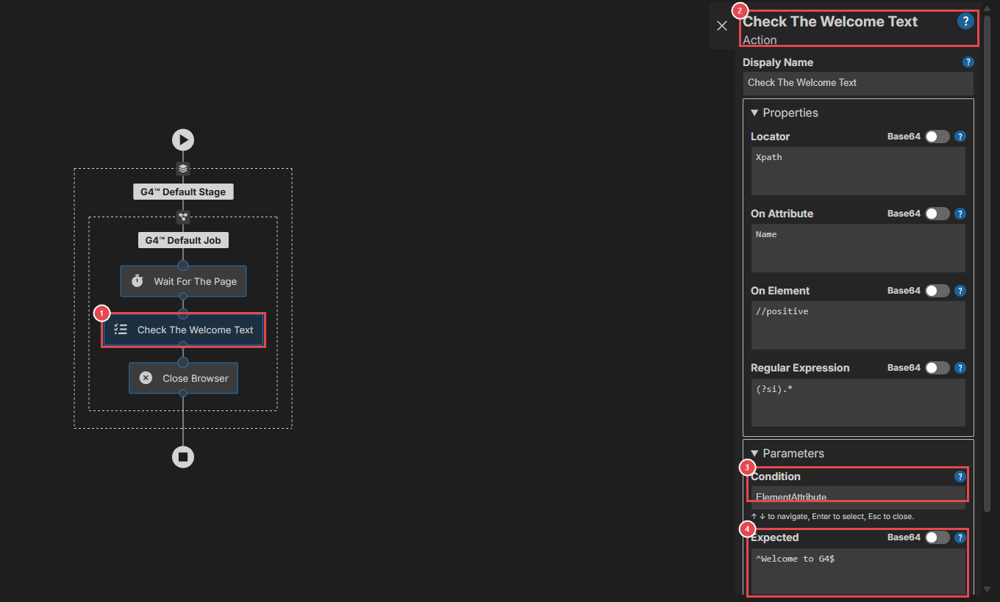
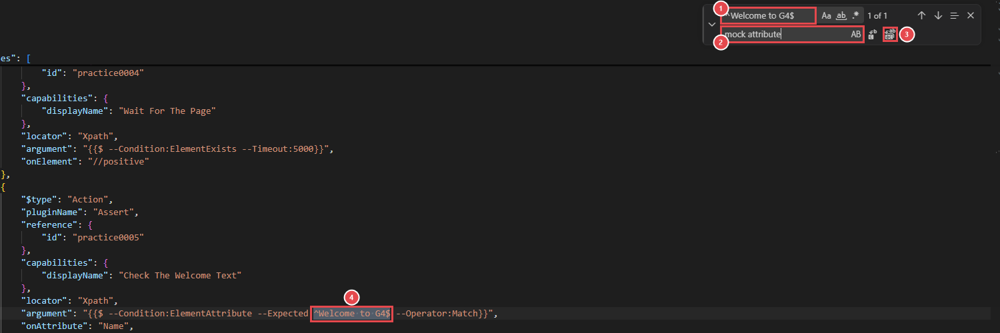
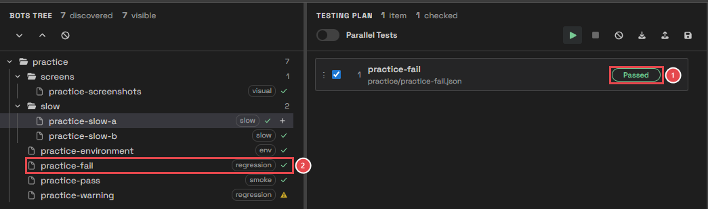
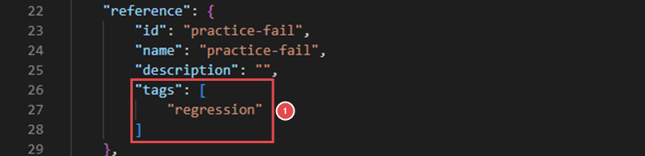

# Module 11: Make your bots better tests

[⬅ Back to overview](README.md)

⏱️ **About 6 minutes**

📍 **Where you are:** back at **Bots**, the start of the line. Test Wright can only tell you what your bots tell it. In this module you'll make a bot report the truth: pass when things are right, fail when they're wrong.

In this module, you will:

- Understand when a bot fails, and when it only warns
- Read a check (assertion) step
- Fix the failing practice bot
- Add tags to a bot

---

## When does a bot fail?

A bot **fails** only when one of its **checks** is false. A check is a step that compares the **expected** value with the **actual** one — for example "the page title must be *Welcome*". In G4 a check is the **Assert** step.

So:

- A bot **without** a check can never fail. It may click the wrong button and still pass. Give every bot at least one check that proves it did its job.
- A bot gets a **warning** when no check failed, but a step had a problem on the way — for example a button that took too long to appear. Look at it, but it is not a failure.
- A bot is **broken** when it couldn't run at all — usually the engine wasn't reachable.

---

## Step 1: Read a check step

Double-click **practice-fail** in the Bots Tree, and click the step **Check The Welcome Text**:

1. **The check step** — an **Assert** step, shown with a list-and-check icon.
2. **Its settings** — the panel on the right shows what the step does. **On Element** and **On Attribute** say what it reads from the page.
3. **Condition** — how it checks: **ElementAttribute** compares a value read from the page.
4. **Expected** — what the value must match: `^Welcome to G4$`. The page actually says `mock attribute value` followed by a number, so the check is false and the bot **fails**.

> **📝 Note:** Expected values are often **patterns**: `^` means "starts here", `$` means "ends here", and `[0-9]+` means "one or more digits". `mock attribute` matches any text that contains those words.

To add a check to one of your own bots, search the Workflow Editor's **Toolbox** for **assert**, drag the **Assert** step into the flow, and fill in its settings. The G4 Engine Client's own learning path shows how to build a flow step by step.

---

## Step 2: Fix the failing bot

The expected text is wrong, so you'll change it. The quickest way is to edit the bot file as text.

1. Close the Workflow Editor tab.
2. Press `Ctrl+P` (`Cmd+P` on a Mac), type `practice-fail.json`, and press `Enter`. The bot opens as text.
3. Press `Ctrl+H` (`Cmd+Option+F` on a Mac) to open **Find and Replace**:

1. **Find** — type `^Welcome to G4$`.
2. **Replace** — type `mock attribute`.
3. **Replace All** — changes the text in the file.
4. **The expected value** — the text you are replacing, inside the check's `argument`.

Then press `Ctrl+S` (`Cmd+S` on a Mac) to save, and close the tab.

Now put **practice-fail** alone in the plan and press **Run**:

1. **Passed** — the check is now true.
2. **The tree** — the mark next to practice-fail changed from ✗ to ✓.

---

## Step 3: Add tags to a bot

Tags let you find and pick groups of bots (Module 3). They are written in the bot file, in its `reference` section:

1. **`tags`** — a list of words between `[` and `]`, each in quotes, separated by commas. For example `"tags": ["regression", "login"]`.

Save the file, then press **Discover Bots**: the new tags appear in the tree and in the tag filter.

> **💡 Tip:** Agree on a few tags with your team, such as `smoke` (a quick check of the most important things), `regression` (the full check), and a tag per feature (`login`, `checkout`). A good set of tags makes building plans fast.

---

## Step 4: Take screenshots

A screenshot shows what the page looked like at a step, which makes a failure much easier to understand. You saw one in the Allure report in Module 9.

- Add a **SaveScreenshot** step where you want a picture (search the Toolbox for **screenshot**).
- Or open the bot's **G4™ Screenshots Settings** (click an empty spot of the Workflow Editor's canvas) to take pictures automatically.

---

## 🧪 Try it

Make **practice-fail** pass by fixing its expected value, as in Step 2.

**You should see:** **Passed** for practice-fail, and a ✓ next to it in the Bots Tree.

> **💡 Tip:** Want the failing bot back for practice? Delete `bots/practice/practice-fail.json` and run **Add Practice Bots** again: it adds back only the missing file.

---

## ✔ Check your work

- [ ] You can explain why a bot without a check can never fail
- [ ] You found the **Expected** value of a check
- [ ] practice-fail now passes
- [ ] You know where a bot's tags are written

---

**Next up** 👉 [Module 12: Capstone — a nightly smoke run](12-capstone-nightly-smoke-run.md)
