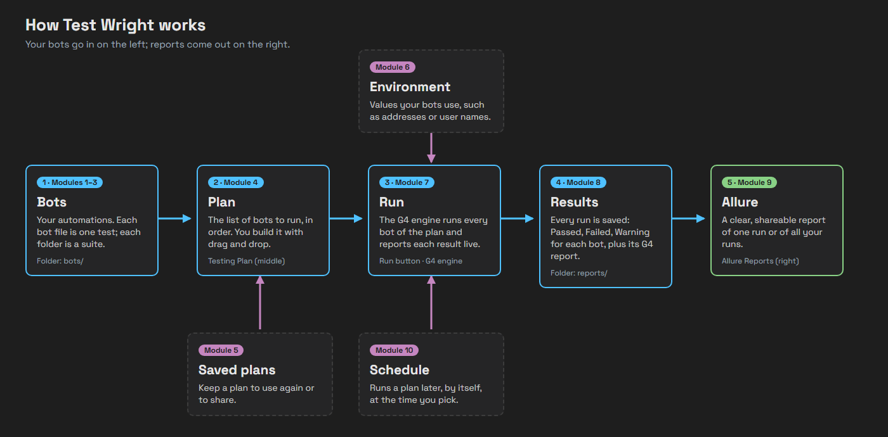

# Module 12: Capstone — a nightly smoke run

[⬅ Back to overview](README.md)

⏱️ **About 5 minutes** (plus a short wait)

📍 **Where you are:** the whole line, from start to end. You'll do a real task the way you would at work, using everything you've learned.

---

## The task

Your team wants a **smoke run** every evening: a quick check of the most important bots, so problems are found before the next morning. A smoke run is small and fast.

You'll build it from the practice bots, save it, and schedule it. Each step names the module that shows how, in case you need a reminder.

---

## Step 1: Mark the smoke bots (Module 11)

**practice-pass** is already tagged `smoke`. Add the `smoke` tag to **practice-environment** too:

1. Open `practice-environment.json` as text (`Ctrl+P`, type the name, `Enter`).
2. In its `reference` section, find `"tags"`. Below it is `"env"`. Add a comma after `"env"`, then `"smoke"`, so the list holds `"env", "smoke"`.
3. Save the file (`Ctrl+S`) and close it.

---

## Step 2: Find the smoke bots (Module 3)

Press **Discover Bots**, then tick **smoke** in the tag filter.

**You should see:** two bots — practice-environment and practice-pass.

---

## Step 3: Build and save the plan (Modules 4 and 5)

1. Clear the plan.
2. Drag the **practice** suite onto the plan. Because the tree is filtered, only the two smoke bots are added.
3. Turn **Parallel Tests** on — smoke bots don't depend on each other.
4. Save the plan to the repository as `nightly-smoke`.

---

## Step 4: Pick the environment (Module 6)

Pick **Practice** in the header. practice-environment needs it.

---

## Step 5: Schedule it (Module 10)

Schedule the plan two or three minutes from now, and give it the label **Nightly smoke**. (At work you would pick tonight's time.)

Then wait for it to run. You can close the Test Wright tab while you wait — the run still happens.

---

## Step 6: Check the results (Modules 8 and 9)

1. In the **Test Reports Repository**, click **Nightly smoke**.
2. Read the Run Report.
3. Click **Open Allure** to see the Allure report.

**You should see:** a run labeled **Nightly smoke** with **2 bots, 2 passed**, and an Allure report with a success rate of 100%.

---

## ✔ You did it

- [ ] Two bots carry the `smoke` tag
- [ ] **nightly-smoke** is saved in the Test Plans Repository
- [ ] The **Nightly smoke** run ran by itself, with the Practice environment
- [ ] You read its results in the Run Report and in Allure

🎉 **Congratulations!** You can now run any of your bots as tests, keep and share plans, run them on schedule, and read and share the results.

## Where to go next

- **Use your own bots.** Everything you did works the same with the bots of your project.
- **Keep the practice bots** for trying things out, or delete the `bots/practice` folder and `environments/Practice.json` when you no longer need them.
- **Stuck?** See [Troubleshooting](troubleshooting.md).

---

[⬅ Back to overview](README.md)
